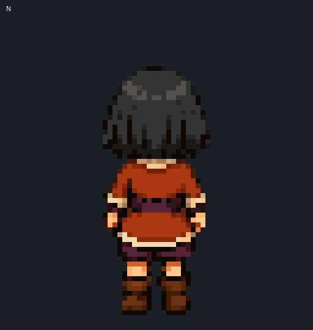
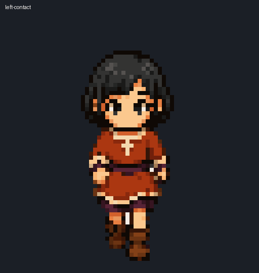

# Discrete Sprite Lab · 离散精灵实验室

这是一个展示 AI 原生像素美术生产方法的公开研究与艺术仓库，包含可用的角色帧、美术来源、完整方法论、可复现 Skills、开发经历，以及真正推动流程前进的失败版本。

> 仓库目前公开可见，但尚未授予复用许可证。复制或再发布前请阅读 [RIGHTS.md](RIGHTS.md)。

## 当前艺术包

- 黑发小女孩八方向 idle：`8 × 64×64 RGBA`
- 黑发小女孩南向 walk：`6 × 64×64 RGBA`，每帧 120 ms

每个正式资产都附带最终帧、spritesheet、快慢 GIF、高精细来源、伪像素来源、审查图、审计 JSON 与回执。

## 核心方法

我们的突破不是让 AI 直接“画 64×64 小图”，而是建立明确的空间边界：

1. 在高精细图像空间中分别生成完整视角或动作相位。
2. 在高精细空间检查人体、身份和动作语义。
3. 转换成高分辨率伪像素图。
4. 通过 Perfect Pixel majority sampling 恢复离散网格。
5. 恢复后只允许 `1:1` 像素放置，禁止二次缩放。
6. 在 `宽 × 高 × 4` RGBA 离散空间进行局部语义推理。
7. 头部、五官、刚性标志等稳定身份块可以用精确像素集合对齐；透明像素也必须参与擦除旧轮廓。
8. 裙摆、袖口、手、腿、鞋等动作部位保持相位专属，不能用一个全局遮罩覆盖。
9. 尺寸、Alpha、哈希、越界、重采样属于硬门槛；节奏比等数值只是视觉诊断，不能替代正常速和慢速动画审查。

完整内容见 [方法论](docs/methodology.md)、[开发日志](docs/development-journal.md) 与 [失败图谱](docs/failure-atlas.md)。

## 当前边界

- 已批准：八方向 idle、南向六帧 walk。
- 尚未完成：另外七个方向的 walk。
- 未收录：Village_Rim 游戏代码、Unity 工程缓存、原艺术包及授权不清的参考图。
- 尚未决定：艺术、代码与文档的正式许可证。
