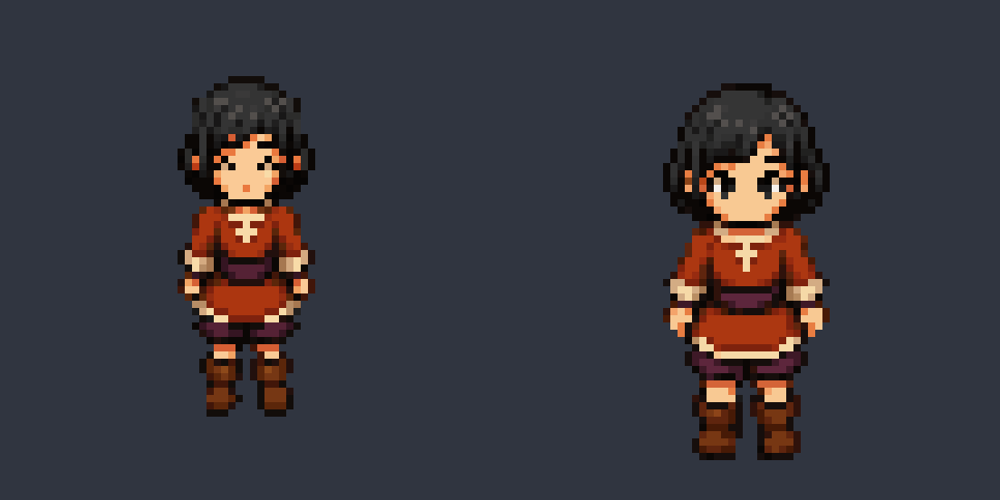
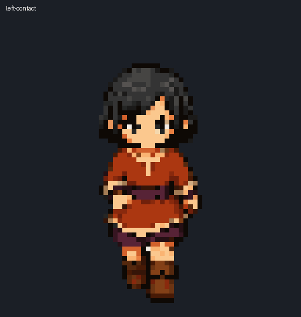
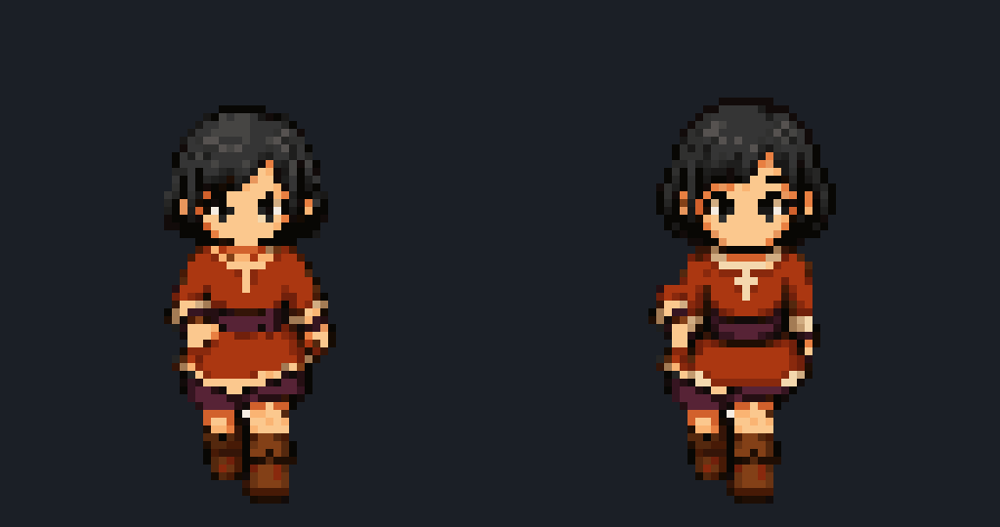

# Failure atlas

Failure artifacts are first-class production evidence. Each case below changed a pipeline invariant.

## F1 — post-recovery resampling

**Symptom:** eyes, eyebrows, hair breaks, and other one-cell features became muddy.

**Cause:** recovered logical pixels were resized a second time to normalize character height.

**Invariant learned:** after Perfect Pixel recovery, use only `1:1` placement and integer translation.

## F2 — weak temporal phase control

**Symptom:** the loop contained unique images, but contact, recoil, passing, and closure did not form a convincing symmetric cycle.

**Cause:** frame prompts described appearance more strongly than planted foot, swing trajectory, body bob, and paired phase semantics.

**Invariant learned:** define phase cards first and generate paired keys before in-between phases.

## F3 — broad identity mask and global mirroring

**Symptom:** cadence metrics became exactly symmetric while arms detached and seams crossed articulated joints.

**Cause:** a broad rectangular identity overlay crossed shoulders, wrists, waist, hips, knees, and ankles; global mirroring duplicated the malformed anatomy.

**Invariant learned:** generate complete bodies separately and restrict exact patches to bounded semantic features with context-ring review.

## F4 — treating a diagnostic as a verdict

The final walk's paired silhouette-change ratio exceeded an early scalar reference. Normal and slow review still showed coherent motion and received explicit user approval.

**Invariant learned:** dimensions, Alpha, hashes, bounds, and resampling are hard checks. Cadence and silhouette distances are visual diagnostics unless a contract explicitly promotes them to a hard gate.
