# Methodology: reasoning on a discrete sprite

**Current routing (2026-10-10):** static eight-direction portraits retain the
spatial Skill; new actions use procedural motion or authored key poses with PixelLab inbetweens. See
[current action routing](pixellab-actions.md). The native/generated temporal
methods below document the provenance of the retained publication and are
retired as production routes.

## 1. The representation matters

A logical sprite is not a low-resolution photograph. It is an exact `width × height × 4` RGBA field. Two neighboring cells may have identical colors or an abrupt discontinuity, and a transparent cell can be just as important as an opaque one because it erases the previous silhouette.

This changes the division of labor:

- **The agent owns semantics:** identity, anatomy, phase, occlusion, feature class, anchors, context, and visual approval.
- **Scripts own exact algebra:** lossless RGBA I/O, integer coordinates, nearest-neighbor display, exact diffs, bounded writes, hashes, and receipts.

Scripts must not decide that a component is an eye, hand, boot, or valid action phase.

## 2. End-to-end pipeline

```mermaid
flowchart LR
    Contract[Asset and phase contract] --> Route{Available source and motion}
    Route --> Master[Approved same-view native master]
    Master --> Cels[Shared identity cels and authored phase geometry]
    Cels --> Local
    Route --> Detail[Separate complete high-detail images]
    Detail --> DetailReview[Native high-detail review]
    DetailReview --> Pseudo[Separate high-resolution pseudo-pixel images]
    Pseudo --> PseudoReview[Native pseudo-pixel review]
    PseudoReview --> Recover[Perfect Pixel majority recovery]
    Recover --> Place[1:1 integer placement on logical canvas]
    Place --> Palette[Shared palette and binary Alpha]
    Palette --> Local[Agent-selected exact local RGBA patches]
    Local --> Magnify[16x-32x nearest-neighbor review]
    Magnify --> Loop[Normal and slow cyclic review]
    Loop --> Audit[Hard checks, diagnostics, hashes, receipt]
```

## 3. Choose native construction or complete generated frames

For a viable approved same-view native master, construct the action directly in logical pixels: declare joints and body offsets, reuse suitable stable cels, erase superseded idle limbs, and author phase-specific geometry and occlusion. Review the native master and every resulting frame. There is no high-detail generation, pseudo-pixel conversion, or recovery stage to fabricate in this route.

For generated work, multi-frame image-generation sheets reduced detail and frequently produced duplicate phases, perspective drift, baked backgrounds, and inconsistent character scale. Generate each direction or action phase as a complete high-detail image and review it separately.

For a six-frame walk, define semantic phases before authoring: opposite contacts, opposite recoil poses, and opposite passing poses. Frame numbers alone are not pose specifications. Frame counts, bob amplitudes, and durations follow the intended action; the walk example is not a universal template.

## 4. Recover, do not resize

Perfect Pixel majority sampling recovers the logical cells from a reviewed pseudo-pixel lattice. After recovery:

- no bilinear, bicubic, Lanczos, antialiasing, or fractional resampling;
- no blur, denoise, morphology, optical flow, or continuous warping;
- only exact cropping, integer translation, transparent padding, palette mapping, and binary Alpha.

A shared refined grid is preferred. Independently generated sources may use different recorded integer grids if every source and final loop passes review. Continuous scaling is never used merely to manufacture shared-grid evidence.

Native inputs already define their logical cells and bypass recovery. Their packager copies exact PNGs and assembles a 1:1 strip; it never infers anatomy, registers the body, recolors, or resamples the frame.

## 5. Stable identity versus phase-specific geometry

Every local feature is classified before repair:

- `stable_identity`: a complete same-view head and face, rigid emblem, or fixed ornament. It may reuse one canonical exact RGBA set with declared integer bob offsets.
- `phase_specific`: skirt hems, sleeves, cuffs, hands, legs, and boots. These change topology and occlusion, so contact, recoil, and passing families stay separate.

An exact patch includes its transparent erase footprint and a reviewed one-pixel context ring. It must not cross an articulating neck, shoulder, elbow, wrist, waist, hip, knee, or ankle boundary.

Shape stability is not canvas immobility: a shared head follows its neck/body transform. Alpha centroids do not establish anatomical anchors. Shared native construction cels use explicitly authored joints; they do not authorize broad torso overlays across mismatched generated bodies. Review both limbs and all occlusion orders, including old idle-hand remnants and accidentally hidden far arms/boots.

## 6. Review at a scale the reviewer can read

Every logical `64×64` frame is enlarged to at least `1024×1024` with nearest-neighbor sampling. Review proceeds hierarchically:

1. whole silhouette and action phase;
2. head, torso, arms, skirt, and legs;
3. eyes, brows, hair breaks, emblem, cuffs, and shoes;
4. the one-pixel context ring around any exact patch;
5. the cyclic animation, including last-to-first closure.

## 7. Hard checks and visual diagnostics

Hard integrity failures cannot be waived:

- wrong count or dimensions;
- empty or duplicate frames;
- partial Alpha or palette violation;
- out-of-bounds writes or stale hashes;
- prohibited post-recovery resampling;
- failed required contacts, grid policy, or an explicitly promoted contract gate.

Silhouette-change distance and paired-cadence ratios are diagnostics by default. A diagnostic outside its reference range must remain visible and requires normal-speed and slow-loop evidence, a reason, and named user or agent visual authority. It cannot approve or reject subjective motion automatically.

The existing generated action processor also enforces configured silhouette/shift/palette bounds as technical gates. Declare those processor limits in its contract; a visual review does not silently waive them. Native packaging does not introduce those metric gates.

## 8. Spatial and temporal axes stay separate

`create-topdown-8dir-sprites` owns spatial rotation continuity for one approved pose. `create-fixed-direction-action-sprites` owns temporal continuity for one direction and action. A complete `directions × phases` sheet is assembled only after both axes pass independently.

With directional native masters, author a complete temporal cycle separately for each view. When generated phases are expanded spatially, review every resulting direction as a full temporal row. Six individually acceptable turnarounds can still produce inconsistent head shape, body mass, or phase spacing when played over time. Stable identity, technical integrity, agent motion judgment, user preservation approval, and engine import remain distinct evidence.
